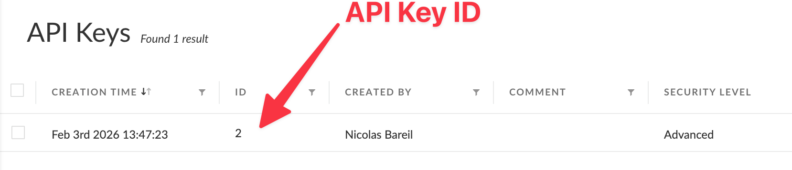

# xdr-cli

Interact with XDR using the command-line.

All platforms are supported: Linux, Mac, and Windows.


[[_TOC_]]

# Installation

```
$ git clone https://github.com/nbareil/xdr-cli.git
$ cd xdr-cli
$ sudo apt install python3-venv
$ python3 -m venv venv && source venv/bin/activate && pip install .
$ xdr-cli --help
```

# Getting started

xdrcli is designed to be used with many tenants at the same time, in order for you to juggle easily between customers. For each client, you will define an alias name and specify the full URL and the API key and Identifier.

First, you have to add a tenant to your configuration:

```
$ xdr-cli config tenant add demo
Base URL (without https://): your-tenant.xdr.us.paloaltonetworks.com
Create an Advanced API key manually on https://your-tenant.xdr.us.paloaltonetworks.com/configuration/api-keys then:

API Key Hash: xxx
API Key ID: 123
```

The Key ID can be found here:



It is recommended to configure it with an expiration time (2 months from now is generally enough). In terms of privilege, you should use the "*Privileged Responder*" role.

The tenant credentials are stored in `~/.xdr-cli-auth.json`, which is written with `0600` permissions (owner read/write only).

For non-interactive setups (CI, agents), pass everything as flags instead of answering prompts:

```
$ xdr-cli config tenant add demo \
    --base-url your-tenant.xdr.us.paloaltonetworks.com \
    --api-key-hash xxx --api-key-id 123 --yes
```

Now, you are good to go:

```
$ xdr-cli --profile demo incident list
```

# Using xdr-cli from scripts and AI agents

`xdr-cli` is designed to be driven non-interactively. A few global options make it
predictable for scripts and AI agents:

- `--json` wraps every command's output in a stable envelope: `{"ok": true, "data": ...}`
  on success, or `{"ok": false, "error": {"code": ..., "message": ...}}` on failure. The
  process exit code is also stable: `0` success, `2` usage/validation error, `3` partial
  result (an interrupted listing), `4` not found, `1` other errors.
- `--read-only` (or the `XDR_CLI_READONLY` environment variable) refuses every mutating
  operation (close, isolate, scan, quarantine, script run, triage). Useful when you want an
  agent to be able to look but not touch.
- `--dry-run` (on every mutating command) prints what *would* happen without calling the API.
- `--fields a,b,c` and `--limit N` on the `list` commands keep output small and focused.
- `alert list`, `endpoint list` and `incident list` fetch every page by default, retrying
  timeouts, rate limits (429) and transient 5xx errors with backoff. Without `--json`, rows
  print as each page arrives, so a long listing uses little memory.
- `--limit N` stops after N rows, and the response includes a cursor for the rest. With
  `--json`, `meta` holds `count`, `total_count`, `next_cursor` and `sort`. Pass `next_cursor`
  back alone as `--cursor` to continue. It is `null` once the listing is complete. Without
  `--json`, a `next page: --cursor ...` hint goes to stderr.
- If a page still fails after retries, the rows fetched so far are kept and the command exits
  with code `3`. The error message carries the cursor to resume from. With `--json`, the
  error envelope also includes the partial `data` and `meta.next_cursor`.
- `--offset N` skips the first N rows. Prefer `--cursor` to continue a listing: XDR rejects
  deep offsets (roughly past 10,000 rows), while cursors don't have that limit.
- Results are always explicitly sorted, so a cursor resumes exactly where it stopped. Use
  `--sort FIELD` and `--order asc|desc` to change it. Defaults: alerts `creation_time` desc,
  incidents `creation_time` desc, endpoints `first_seen` asc. These time fields let the CLI
  page with a "since the last row" filter instead of a growing offset, so very large
  listings work. Other options (alerts `severity`, incidents `incident_id`, endpoints
  `endpoint_id`) page by offset and hit the deep-offset limit on large tenants.

```
$ xdr-cli --json --read-only endpoint list --platform linux --fields endpoint_name,ip --limit 5
{"ok": true, "data": [{"endpoint_name": "host1", "ip": ["10.0.0.1"]}, ...], "meta": {"count": 5, "total_count": 42, "next_cursor": "eyJmIjoiZmlyc3Rf...", "sort": {"field": "first_seen", "order": "asc"}}}

$ xdr-cli --json endpoint list --platform linux --fields endpoint_name,ip --limit 5 --cursor eyJmIjoiZmlyc3Rf...

$ xdr-cli --json endpoint isolate --hostname DESKTOP-V24D23 --dry-run
{"ok": true, "data": {"dry_run": true, "action": "isolate", "endpoint_id": null, "hostname": "DESKTOP-V24D23"}}
```

When no XQL query is supplied and stdin is not a TTY, `xdr-cli` fails fast instead of trying
to open an editor.

# Response actions

```
$ xdr-cli --profile demo endpoint isolate --hostname DESKTOP-V24D23
$ xdr-cli --profile demo endpoint unisolate --endpoint-id 1bd16395ef5a44a1db13033e461d012a
$ xdr-cli --profile demo endpoint scan --hostname DESKTOP-V24D23
$ xdr-cli --profile demo endpoint scan --all --platform windows
$ xdr-cli --profile demo file quarantine --hostname DESKTOP-V24D23 --path 'C:\Temp\evil.exe' --sha256 <hash>
$ xdr-cli --profile demo file restore --sha256 <hash>
```

# MCP server

`xdr-cli` can expose the same operations to AI agents over the Model Context Protocol
(stdio). Install the extra and run the server:

```
$ pip install '.[mcp]'
$ xdr-cli mcp serve --default-tenant demo
```

Each MCP tool accepts an optional `tenant` argument (falling back to `--default-tenant`).
Mutating tools (isolate, scan, close, ...) are hidden entirely when the server is started
with `--read-only` or `XDR_CLI_READONLY=1`.

# Shell completion

Bash:

```
eval "$(_XDR_CLI_COMPLETE=bash_source xdr-cli)"
```

Zsh:

```
eval "$(_XDR_CLI_COMPLETE=zsh_source xdr-cli)"
```

Alternative: generate a static script and source it:

```
$ xdr-cli completion bash > ~/.xdr-cli-completion.bash
$ xdr-cli completion zsh > ~/.xdr-cli-completion.zsh
```

# Examples
## Get information about an endpoint

```
% xdr-cli -p demo endpoint get bookwormvm
{
    "endpoint_id": "a3b8b9c6d48f4bc1bae2320bb3bda078",
    "endpoint_name": "Bookwormvm",
    "endpoint_type": "AGENT_TYPE_SERVER",
    "endpoint_status": "CONNECTED",
    "os_type": "AGENT_OS_LINUX",
    "os_version": "10.13.0",
    "ip": [
        "10.0.2.15"
    ],
    "ipv6": [
        "fec0::4b2:7a69:3bac:1c8e",
        "fec0::5054:ff:fe12:3456",
        "fec0::a0e3:78ce:18f:ef31",
        "fec0::a4db:4946:906f:c2a7"
    ],
    "public_ip": "203.0.113.10",
    "users": [
        "root"
    ],
    "domain": "localdomain",
    "alias": "",
    "first_seen": 1737714227084,
    "last_seen": 1737961790740,
    "content_version": "1630-10375",
    "installation_package": "linux amd64",
    "active_directory": [],
    "install_date": 1737714227112,
    "endpoint_version": "8.6.1.129181",
    "is_isolated": "AGENT_UNISOLATED",
    "isolated_date": null,
    "group_name": [],
    "operational_status": "PROTECTED",
    "operational_status_description": "[]",
    "operational_status_details": [],
    "scan_status": "SCAN_STATUS_NONE",
    "content_release_timestamp": 1737458418000,
    "last_content_update_time": 1737714629021,
    "operating_system": "Debian 10.13",
    "mac_address": [
        "52:54:00:12:34:56"
    ],
    "assigned_prevention_policy": "U42 Linux Policy (Report Only) (2)",
    "assigned_extensions_policy": "",
    "token_hash": null,
    "tags": {
        "server_tags": [],
        "endpoint_tags": []
    },
    "content_status": "UP_TO_DATE"
}
```

You can then be fancy with the JSON output, for example, to programmatically get the endpoint ID:

```
$ xdr-cli -p demo endpoint get bookwormvm | jq -r .endpoint_id
"a3b8b9c6d48f4bc1bae2320bb3bda078"
```

If you are filling in the SoD Systems' tab, you may want its IP address, domain, and OS:

```
$ xdr-cli -p demo endpoint get bookwormvm | jq  '.ip, .domain, .operating_system'
[
  "10.0.2.15"
]
"localdomain"
"Debian 10.13"
```

## Triage

List available triage presets:

```
$ xdr-cli -p demo triage presets
```

Start a triage on a host:

```
$ xdr-cli -p demo triage new HOSTNAME
```

Optionally specify a triage configuration UUID:

```
$ xdr-cli -p demo triage new HOSTNAME --collector-uuid <UUID>
```

Check status for a triage action ID:

```
$ xdr-cli -p demo triage status 123456789
```


## Get information about an IP address

```
$ xdr-cli -p sandbox-u42 endpoint who-has 10.0.2.15
bookwormvm
```

## Get a list of hosts matching conditions

List Linux hosts:

```
$ xdr-cli --profile demo endpoint list --platform linux|jq .endpoint_name|wc -l
2
```

List hosts having the tag XXX:

```
$ xdr-cli --profile demo endpoint list| jq 'select(.tag|contains("XXX")) | .endpoint_name'
```

## Acquire a file on host

```
$ xdr-cli --profile=demo get-file --hostname DESKTOP-V24D23 'C:\Temp\NetMonitor.exe' -o /tmp/net_monitor.zip
```

XDR returns retrieved files in a ZipCrypto-encrypted archive. Python decrypts that format at about 1 MB/s, so install 7-Zip (`7zz`, `7z` or `7za`) or Info-ZIP `unzip`: `get-file` uses the first one it finds in `PATH` and extracts at disk speed. Without either, it falls back to Python.

If you are going to acquire a large number of files, a slight optimization is to specify the *Endpoint ID* instead of the hostname to remove one back-and-forth with the server:

```
$ xdr-cli --profile=demo get-file --endpoint-id 1bd16395ef5a44a1db13033e461d012a /usr/local/bin/evil_service -o /tmp/evil_service.zip
```

## Bulk acquisition of files


Let's say you need to acquire a specific file on all Linux hosts, use the following loop:

```
$ for id in $(xdr-cli --profile demo endpoint list --platform linux|jq .endpoint_id); do
  xdr-cli --profile demo get-file --endpoint-id "$id" '/root/.bash_history' -o /tmp/collections/
done
```

## Acquire a file larger than the get-file limit

The agent refuses to retrieve files over a size limit set by the tenant, with `Maximum file size reached`. `get-large-file` works around it with an endpoint script, in one of two ways:

- `--via chunks` (default): the endpoint gzips the file one chunk at a time, and each chunk comes back through a regular file retrieval. It needs nothing but XDR, so it works on isolated endpoints, but it is as slow as file retrievals are.
- `--via sftp`: the endpoint uploads the file to an SFTP server. Much faster, but the endpoint must reach the server.

Both check the SHA-256 of the whole file, and both resume when you rerun the same command after a failure.

```
$ xdr-cli --profile demo get-large-file --hostname DESKTOP-V24D23 'C:\Windows\MEMORY.DMP' -o MEMORY.DMP
```

In chunk mode, at most one chunk sits on the endpoint's disk at a time, in `%TEMP%\xdrlf-<job>` or `/tmp/xdrlf-<job>`, and the staging directory is deleted at the end, including after an error. If the tenant refuses a chunk, `get-large-file` halves `--chunk-size` (100M by default) and tries again. Each chunk checks that the file's size and mtime haven't changed, so a file that is still being written fails fast instead of being reassembled inconsistently.

The SFTP mode needs `paramiko` on the workstation (`pip install 'xdr-cli[sftp]'`); the endpoint uses the `pysftp` module bundled with the agent. `get-large-file` reads the server's host key from the workstation and the endpoint checks the server against it; pass `--sftp-host-key` to pin it instead. Uploads go to `<remote-path>.part`, renamed when complete, in actions of `--time-budget` seconds chained until done. With `-o`, the file is downloaded back and checked against the endpoint's SHA-256; `--delete-remote` then removes it from the server.

```
$ xdr-cli --profile demo get-large-file --hostname DESKTOP-V24D23 'C:\Windows\MEMORY.DMP' \
    --via sftp --sftp-host sftp.example.com --sftp-user case42 --sftp-password-file pw.txt \
    -o MEMORY.DMP --delete-remote
```

The SFTP password is embedded in every upload script, and the tenant keeps scripts in its action history. Use an account dedicated to the case and change its password afterwards.

Files that another process holds open exclusively, such as registry hives or `NTDS.dit`, can't be read by the script; copy them from a volume shadow copy first. `--print-script` prints the endpoint script, to run it by hand from the XDR console after editing its `CONFIG` block.

## Execute XQL commands

You can execute XQL queries from the command-line:

```
$ xdr-cli --profile demo xql "dataset = xdr_data| filter action_process_username ~= "root"| fields _time,action_process_image_name'
```

By default, the JSON results will be output directly on the standard output in order for you to be able to pipe it to JQ and perform some magic voodo.

But if you are more an Excel master, you may enjoy the `--excel` flag that directly converts the ouptut to a full blown XLSX sheet:

```
$ xql_query='dataset = xdr_data| filter action_process_username ~= "root"| fields _time,action_process_image_name'
$ xdr-cli --profile demo xql  --excel -o my_sheet.xlsx  "$xql_query"'
```

You can also specify the dates as parameters:

```
$ xdr-cli --profile=demo  xql "$xql_query" --begin-time "2023-09-01 00:00:00" --end-time "2024-09-30 11:00:00"
```

And you are not even required to type the XQL query in the parameter, if you don't specify one, xdr-cli will automatically open your favorite text editor. The query will be automatically executed when you exit it:

```
$ xdr-cli --profile=demo xlq
```

## Script execution

You can run execute Python scripts directly on a list of endpoint hostnames:

```
$ echo 'print "Hello world"' >  hello.py
$ xdr-cli -p demo script run --hostname DESKTOP-V24D23 --hostname DESKTOP-4UB2  hello.py
{"action_id": 522, "status": 1, "endpoints_count": 2}
```

Add `--wait` to block until the script finishes and return its results in one call (handy
for agents, which otherwise have to poll `script status` and then `script results`):

```
$ xdr-cli -p demo script run --hostname DESKTOP-V24D23 --wait hello.py
```

You can also specify endpoint IDs directly, or mix endpoint IDs and hostnames. Endpoint IDs avoid a hostname lookup round trip:

```
$ xdr-cli -p demo script run -e 3ab2dfe3ded3416fad12f1c638eddf8b -e 677161eee18749df90adf0783bda9a21  hello.py
{"action_id": 523, "status": 1, "endpoints_count": 2}
```

Then you can get its execution status using the provided Action ID:

```
% xdr-cli -p demo script status 522|jq .
{
  "general_status": "COMPLETED_SUCCESSFULLY",
  "endpoints_pending": 0,
  "endpoints_canceled": 0,
  "endpoints_in_progress": 0,
  "endpoints_timeout": 0,
  "endpoints_failed": 0,
  "endpoints_completed_successfully": 2,
  "endpoints_pending_abort": 0,
  "endpoints_aborted": 0,
  "endpoints_expired": 0
}
```

Finally, you can request the script results:

```
$ xdr-cli -p demo script results 522|jq .
{
  "script_name": "\"snippet script\"",
  "script_description": null,
  "script_parameters": [],
  "date_created": "2025-01-23 08:34:28",
  "scope": "\"pw-zzz\"and 2 other endpoint",
  "error_message": "",
  "results": [
    {
      "endpoint_name": "pw-yyy",
      "endpoint_ip_address": [
        "10.2.44.12"
      ],
      "endpoint_status": "STATUS_010_CONNECTED",
      "domain": "demo.com",
      "endpoint_id": "677161eee18749df90adf0783bda9a21",
      "execution_status": "COMPLETED_SUCCESSFULLY",
      "standard_output": "Hello world",
      "retrieved_files": 0,
      "failed_files": 0,
      "retention_date": null
    },
    {
      "endpoint_name": "pw-xxx",
      "endpoint_ip_address": [
        "10.2.45.12"
      ],
      "endpoint_status": "STATUS_010_CONNECTED",
      "domain": "demo.com",
      "endpoint_id": "3ab2dfe3ded3416fad12f1c638eddf8b",
      "execution_status": "COMPLETED_SUCCESSFULLY",
      "standard_output": "Hello world",
      "retrieved_files": 0,
      "failed_files": 0,
      "retention_date": null
    }
  ]
}
```

Or extract the output:

```
$ xdr-cli -p demo script results 522|jq \
    '.results[]
    | select(.execution_status == "COMPLETED_SUCCESSFULLY")
    | { "endpoint_name": .endpoint_name, "standard_output": .standard_output}'
    {
      "endpoint_name": "pw-xxx",
      "standard_output": "Hello world"
    }
    {
      "endpoint_name": "pw-yyy",
      "standard_output": "Hello world"
    }
```

## Yara memory scan

Perform a memory scan of all processes using a Yara ruleset.

```
$ xdr-cli -p demo script yara-memory-scan -e 3ab2dfe3ded3416fad12f1c638eddf8b -e 677161eee18749df90adf0783bda9a21  chisel.yara
{"action_id": 537, "status": 1, "endpoints_count": 2}

$ xdr-cli -p demo script results 537
...
```

You can also use the `--all` flag to perform the scan on all endpoints, please
note that in this scenario, you must select a platform:

```
$ xdr-cli -p demo script yara-memory-scan --all --platform windows  chisel.yara
...
```


## Closing all alerts related to a given Alert name

In the following snippet, in the context of a CTF, we wanted to remove the 50k alerts that were raised quite rightly by Cortex XDR about CobaltStrike BEACON traffic to makes things easier for the students:

With the XDR logic, we have to:
1. List the incidents matching the noisy alert
2. For each incident, list of alerts that were raised
3. For each alert, close it
4. Finally, there is no alert remaining linked to the incident, close the whole incident

This gives the following loop:

```
incidents=$(xdr-cli --profile ctf incident list| jq 'select(.description|contains("Possible Beacon Traffic Detection")) | .incident_id' | sed 's/"//g')
for incident_id in $incidents; do
    alerts=$(xdr-cli --profile ctf incident get "$incident_id" | jq '.alerts.data[].alert_id'| sed 's/"//g')
    echo $alerts
    for alert_id in $alerts; do
            xdr-cli --profile ctf alert close "$alert_id"
    done
    xdr-cli --profile ctf incident close "$incident_id"
done
```
